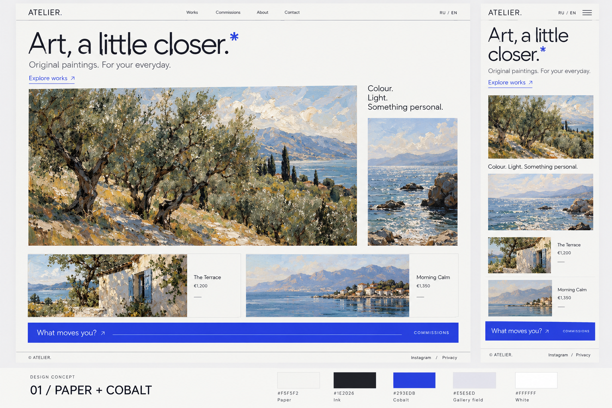
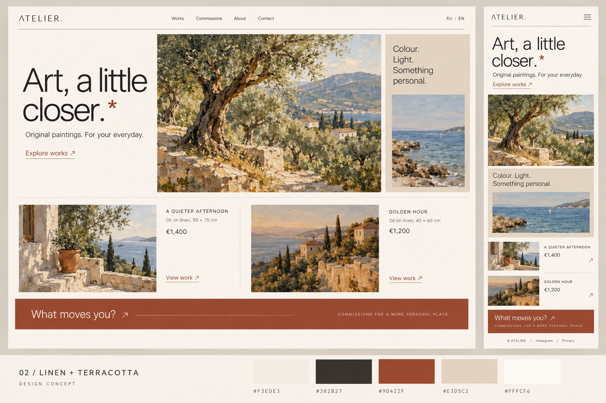

# Два направления для выбора

Это изображения концептов, подготовленные **после завершения изменений приложения**, через встроенный imagegen. Это не скриншоты готовых страниц. Условные картины, цены и имя ATELIER служат только для оценки дизайна; они не добавлены в каталог сайта.

Можно показать другу два изображения ниже и выбрать характер: прохладная графичная галерея или тёплая мастерская. В приложении сейчас реализовано первое направление, но композиция концепта не является точной спецификацией кода. Цвета на AI-изображениях приблизительные; для реализации используем HEX из таблицы.

## 01 · Paper / Cobalt

Светлая бумага, контрастная типографика и кобальтовые ссылки. Более графичное, собранное настроение.

[Открыть изображение в полном размере](01-paper-cobalt.png)

## 02 · Linen / Terracotta

Лён, песок и терракота. Более тёплое настроение, близкое к материалам мастерской. Содержание и иерархия похожи, генератор немного изменил компоновку — сравнивать стоит прежде всего цвет и настроение.

[Открыть изображение в полном размере](02-linen-terracotta.png)

## Точные палитры

| Роль        | Paper / Cobalt | Linen / Terracotta |
| ----------- | -------------- | ------------------ |
| Фон         | `#F5F5F2`      | `#F3EDE3`          |
| Текст       | `#1E2026`      | `#302B27`          |
| Акцент      | `#293EDB`      | `#9D422F`          |
| Фон картин  | `#E5E5ED`      | `#E3D5C2`          |
| Поверхность | `#FFFFFF`      | `#FFFCF6`          |

После выбора: переносим палитру в `src/styles/tokens.css`, проверяем её рядом с настоящими картинами и проверяем контраст текста, полей и кнопок. Автоматическая смена темы и валюта по языку в этой итерации не добавлялись.

[Запросы генерации](PROMPTS.md) · [Описание реализованного дизайна](../REFRESH.md)
