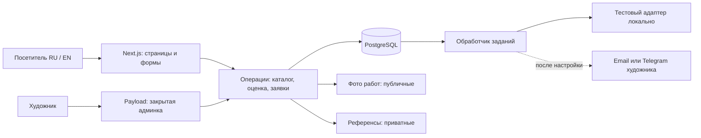
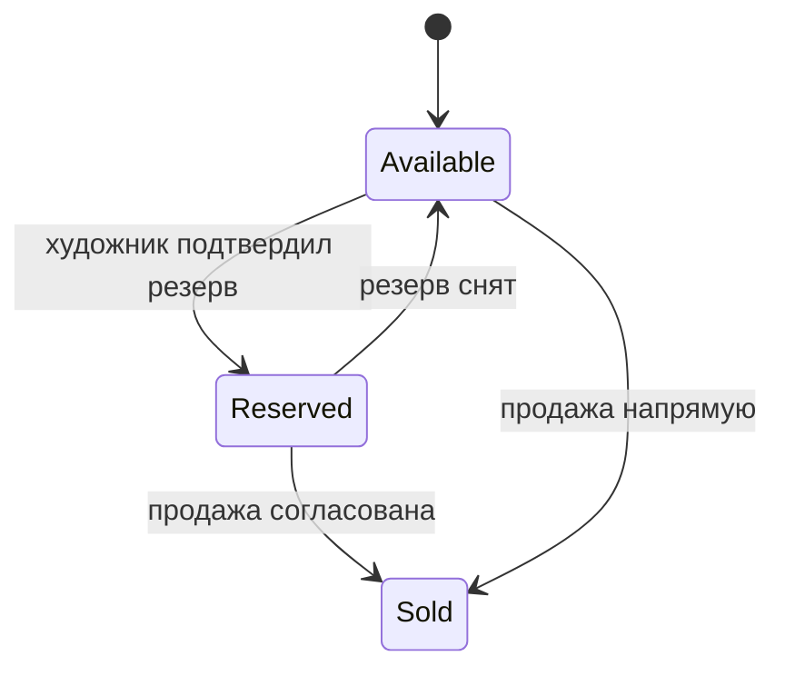

# Архитектура

Статус: рекомендуемый вариант. Конкретные совместимые версии фиксируем после технической проверки M2 в [roadmap](ROADMAP.md).

## Сравнение вариантов

| Вариант | Что получаем | Что придётся поддерживать | Когда выбирать |
| --- | --- | --- | --- |
| **Next.js + Payload + PostgreSQL** | Общий TypeScript-проект, витрина и CMS с админкой, локализуемые поля | Свои формы, правила оценки и процесс заявки; обновления приложения | Рекомендуется для индивидуального UX и дальнейшего развития |
| WordPress + WooCommerce | CMS и магазин с готовой коммерческой моделью | Набор плагинов, их совместимость, индивидуальную форму заказа | Если стандартный магазин и работа через WordPress важнее собственной логики |
| Shopify с темой | Управляемый магазин и checkout | Подписку, доступность в стране продавца, адаптацию заявки вместо обычной покупки | Если позже главным станет регулярная торговля, принты и онлайн-оплата |
| Django + Wagtail | CMS на Python и возможность единого серверного приложения | Свои заявки и оценку; отдельный язык от React при его использовании | Если поддерживающий разработчик предпочитает Python |

Это проектная оценка пригодности, не измерение производительности. У Payload есть админка, auth и API [S1]; у Wagtail ecommerce не входит в ядро [S8]. Shopify ориентирован на магазин [S9], WooCommerce поддерживает товарные варианты [S10]. Источники раскрыты в [REFERENCES.md](REFERENCES.md).

При текущих требованиях не нужно сначала строить магазин и затем отключать его checkout. И не нужно писать собственную CMS. Рекомендуемый стек закрывает редактирование контента и оставляет свободу формы заказа.

## Состав приложения

| Область | Решение |
| --- | --- |
| Витрина и сервер | Next.js App Router + TypeScript strict, Node.js runtime |
| Админка, контент, auth | Payload CMS в том же приложении; владелец и редактор с явными правами |
| Данные | PostgreSQL через штатный адаптер Payload и его миграции [S2] |
| Интерфейс | Tailwind CSS с общими CSS-переменными; небольшая библиотека своих компонентов |
| Языки интерфейса | next-intl, маршруты `/ru/...` и `/en/...` [S5–S6] |
| Языки контента | Локализованные поля Payload [S3] |
| Проверка формы | Серверная схема Zod; HTML-валидация и те же ограничения на клиенте |
| Файлы | Две изолированные области: публичные работы и приватные референсы; локальный адаптер в разработке, объектное хранилище перед запуском [S4] |
| Уведомления | Интерфейс адаптера + задания в PostgreSQL; тестовый адаптер локально, выбранный канал позже |
| Проверки | TypeScript/build, Vitest для правил и переходов, Playwright для основных сценариев |

Payload использует Drizzle внутри своего адаптера PostgreSQL [S2]; отдельный Prisma не добавляем. В первой версии также не нужны отдельные NestJS-сервер, Redis, микросервисы, глобальный Redux store или отдельный сервис поиска.

## Схема



Всё серверное — одна кодовая база. Обработчик заданий может запускаться отдельным процессом из того же проекта. Payload Jobs уже хранит задания в БД [S7]; не создаём вторую конкурирующую очередь.

Предлагаемая структура:

```text
src/
  app/
    (site)/[locale]/       # витрина
    (payload)/admin/      # админка
    api/requests/         # контролируемый приём заявок
    api/estimate/         # оценка, если понадобится серверный endpoint
  collections/            # Artworks, Requests, QuoteRules, Media, Users
  globals/                # ArtistProfile, SiteSettings, FAQ
  modules/
    catalog/              # чтение опубликованного каталога
    commissions/          # подбор правил и построение оценки
    requests/             # сохранение и переходы статусов
    notifications/        # задания и адаптеры
  components/             # UI и составные блоки
  config/contacts.ts      # чтение и валидация env
  i18n/
  styles/tokens.css
messages/{ru,en}.json
tests/
```

Схемы CMS описывают хранение. Операции приложения описывают действия: `estimateCommission`, `submitRequest`, `reserveArtwork`, `markArtworkSold`. Компонент не обращается напрямую к внешнему мессенджеру и не вычисляет окончательную цену.

## Данные первой версии

| Сущность | Основные поля и правила |
| --- | --- |
| `Artworks` | ID, стабильный slug, локализованные title/description/alt/SEO; техника, сюжет, размеры в мм, год, рама, упорядоченные публичные фото; amountMinor + currency; draft/published отдельно от available/reserved/sold; избранное; связь с резервирующей заявкой |
| `QuoteRules` | Активность, сюжет, техника, стандартные width/height; priceMin/MaxMinor + currency; leadTimeMin/MaxDays; локализованные условия, версия. Время включает очередь, работу и просушку, исключает доставку |
| `Requests` | ID и публичный номер; тип purchase/commission/question; locale; контакт и канал; ссылка на работу или структурированные пожелания; приватные вложения; снимок цены/срока и версии правила; статус; внутренние заметки; дата/версия принятого уведомления об обработке данных |
| `PublicMedia` | Производные изображений, размеры, локализованный alt, порядок и авторство; публичная выдача только разрешённых публикаций |
| `PrivateReferences` | Владелец-заявка, MIME, размер, случайный ключ; доступ только авторизованным сотрудникам с правами на заявку |
| `ArtistProfile` | Биография, портрет, подход к работе на двух языках |
| `SiteSettings` / `FAQ` | Состояние приёма заказов, тексты процесса и времени ответа, вопросы на двух языках |
| `Users` | Только сотрудники: владелец управляет пользователями и всем контентом; редактор — контентом, без заявок и приватных файлов по умолчанию |
| Задания Payload | Тип уведомления, request ID, попытки, ошибка и время следующей попытки; без копирования референсов в сообщения |

У техники, сюжета и стандартного размера стабильные коды; подписи переводим. Деньги — целое число минимальных единиц и ISO-код валюты, без float. Валюта не выводится из языка или IP: английский не означает доллары, русский не означает рубли. Автоконвертации нет. Для правил оценки на старте одна явно выбранная валюта; валюта каждой готовой картины хранится вместе с ценой.

Результат оценки сохраняем снимком: изменение правила завтра не меняет смысл вчерашней заявки. Реальная договорённость фиксируется художником в заметках; это ещё не платёжный заказ.

## Правила оценки

1. Только активное однозначное совпадение сюжета, техники и стандартного размера даёт автоматический ориентир.
2. Цена и готовность — диапазоны. Готовность означает возможность передать работу после нужной просушки, а не только последний мазок.
3. Свой размер, «не знаю» или отсутствие правила ведут к ручному уточнению. Не масштабируем стоимость линейно по площади.
4. При совпадении нескольких правил считаем конфигурацию некорректной: не показываем случайную цену, предупреждаем владельца.
5. Финальная отправка повторно вычисляет оценку на сервере. Если она изменилась с просмотра, посетитель видит новые условия и подтверждает их; скрытой подмены нет.
6. Ориентир доступен до ввода контактов. Определённый референс может изменить итоговую цену и срок после личного обсуждения.

## Сохранение заявки и уведомления

Проверка ограничений и полей → серверная проверка работы/правила → транзакция «заявка + задание уведомления» → подтверждение посетителю → обработка задания и возможные повторы.

Кнопка блокируется на время отправки, сервер использует idempotency key с уникальным ограничением. Двойной клик не создаёт два обращения. Публичный номер не является ключом доступа к контактам или файлам.

Сбой Telegram/почты не отменяет сохранённую заявку. Если БД не сохранила запись, сайт не сообщает об успехе. После исчерпания попыток ошибка видна в админке. Согласованную транзакцию с Payload Jobs проверяем на M2; если технически не получается, используем явную запись pending-уведомления при сохранении заявки и её подбор обработчиком, без окна потери события.

Локально тестовый адаптер показывает результат в тестовом окружении/админке, не отправляет сообщения и не пишет контакты в общие логи. При деплое включаем один основной канал. Для уведомления художнику достаточно номера, типа заявки и ссылки в закрытую админку. Email и Telegram одновременно не обязательны. Бот Telegram художника настраивается отдельно и получает известный chat ID; это не ссылка на его публичный профиль [S11].

## Наличие и резерв



Статус заявки: `new → discussing → accepted / declined / cancelled`; после выполнения accepted → completed. Наличие картины — отдельное состояние. Новая заявка ничего не резервирует. При принятии purchase-заявки действие резервирования выполняется атомарно с проверкой текущего статуса; конкурирующие действия не могут присвоить одну картину двум людям. Срок резерва в MVP устанавливается и снимается вручную; автоматическое истечение добавляем только после согласования правил.

Редактирование описания или публикации не меняет наличие. Проданная работа остаётся доступна как портфолио. При недавней продаже сервер отклоняет устаревшую заявку на покупку и предлагает уточнить возможность заказа похожей работы.

## Международность

- `/ru/...` и `/en/...` с первого релиза. Корень направляет в предпочтительную поддерживаемую локаль; есть явный переключатель, не сбрасывающий текущую картину.
- Интерфейс — словари next-intl; тексты художника — локализованные поля CMS. Это разные задачи, поэтому одного перевода кнопок недостаточно [S3, S5, S6].
- Slug для работы пока общий для двух языков: проще поддержка ссылок. Перевод slug не обязателен для первой версии.
- `Intl` форматирует деньги, числа, даты и единицы. В данных — мм и UTC; пользователю размер показываем в см с возможностью добавить дюймы позже.
- Формы, ошибки сервера, письма/уведомления клиенту и резюме переводятся. Свободный текст покупателя не переводим без запроса.
- Нет «русского текста под английским URL» при отсутствующем переводе: публикация соответствующей локали требует заполнить обязательные поля. Интерфейс проверяется на пропущенные ключи. До готовности перевода у страницы нет ложного `hreflang`.
- У каждой локали свои title/description и canonical; `hreflang`, sitemap и метаданные карточек; JSON-LD без выдуманных отзывов, доставки и цен.

## Контакты и env

Имена переменных — предложение для будущего `.env.example`, сам файл приложения создаём на M2.

```dotenv
NEXT_PUBLIC_ARTIST_INSTAGRAM_URL=
NEXT_PUBLIC_ARTIST_TELEGRAM_URL=
NEXT_PUBLIC_ARTIST_EMAIL=
DATABASE_URL=
PAYLOAD_SECRET=
NOTIFICATIONS_DRIVER=development
TELEGRAM_BOT_TOKEN=
TELEGRAM_ADMIN_CHAT_ID=
```

Первые три поля намеренно публичные; секреты сервера никогда не получают префикс `NEXT_PUBLIC_`. Instagram/Telegram ссылки допускают только ожидаемые HTTPS-хосты; email проверяется отдельно и используется через безопасный `mailto`. Незаданные контакты не превращаются в фиктивные ссылки. Чтение переменных централизовано; тексты и компоненты не знают их имён.

Контакты, встроенные в клиентскую сборку Next.js, меняются через новую сборку. Это принятое ограничение env-подхода; если потребуется менять их мгновенно, используем серверную конфигурацию или CMS. Остальные секреты хранилища/уведомлений добавим только при выборе сервисов. Локальные секреты не коммитим; `.env.example` содержит пустые значения.

## Файлы и доступ

Предлагаемые лимиты для референсов: JPG/PNG/WebP, до трёх файлов по 5 МБ; проверяем содержимое, размеры изображения и общий размер запроса. Изображения переобрабатываем с удалением EXIF. PDF/SVG и произвольные архивы не принимаем. HEIC или слишком большой файл получает понятное сообщение с альтернативой «добавить ссылку»; необходимость конвертации HEIC решаем по проверке на iPhone.

Приватные референсы не попадают в публичный bucket, sitemap, публичный CMS API или аналитику. Одной авторизации URL карточки недостаточно — выдача каждого файла проверяет права. Для внешнего хранилища используем короткоживущую подписанную ссылку после авторизации либо серверную выдачу. Временные незавершённые загрузки ограничиваем по сроку и очищаем.

Публичное чтение CMS разрешено только для опубликованного контента и явного набора полей. Чтение заявок гостем запрещено; создание идёт через ограниченный endpoint, а не свободный CRUD. Проверяем REST, GraphQL, Local API и выдачу файлов. **Local API Payload по умолчанию обходит access control**: для публичного чтения явно задаём `overrideAccess: false` и ограничения; привилегированные операции разрешаем только внутри проверенного серверного сценария [S12].

В MVP нужны серверная валидация, ограничения частоты на общем для процессов уровне, ловушка для ботов, ограничения загрузок, защита административных сессий и проверка происхождения запросов. CAPTCHA — только если возникнет реальный спам. Отдельная регистрация сотрудников извне закрыта. Перед реальным запуском проверяем доступную защиту входа, восстановление доступа и обязательность второго фактора.

## Локальная работа и последующий деплой

На M2: приложение Node.js, PostgreSQL в локальном Docker, два языковых набора и явные demo-данные. Production-подключений и реальных сообщений нет.

После готовности приложения выбираем один вариант размещения: управляемое Node.js-приложение + PostgreSQL + объектное хранилище, либо контейнер на VPS с понятной ответственностью за обслуживание. Next.js допускает самостоятельное размещение [S13]. Предпочтительнее меньше сервисов и управляемые резервные копии, если бюджет позволяет. Совместимость конкретной платформы с Payload, обработкой изображений и заданиями подтверждаем пробным запуском.

Страна пока не зашита в код, но выбор реальных сервисов нельзя считать независимым от страны оператора, оплаты и требований к данным. На этапе запуска выбираем доступные региональные сервисы и подходящие условия обработки данных. Точные юридические тексты не подменяем шаблоном до выяснения этих условий.

Статьи будущих расходов: домен, приложение, БД и её копии, изображения/трафик, почта, мониторинг. Бюджет и тарифы сравним перед деплоем; бесплатный локальный прототип не обещает бесплатную эксплуатацию.

Production и preview используют разные БД, хранилища и секреты; тестовые формы не посылают реальные сообщения. Делаем резервные копии БД и файлов и проверяем восстановление. Записи заявок и приватные файлы не кэшируем публично. Изменение опубликованной картины сбрасывает кэш каталога; отправка заявки всегда заново проверяет наличие.

## Как расширять

Первое расширение — загрузка художника и очередь, затем при необходимости CRM/дополнительный канал через адаптер. Если понадобится онлайн-оплата, вводим отдельные Orders/Payments и правила подтверждения, таймеров резерва и возвратов; заявка автоматически не становится оплатой. Если появятся тиражи и вариации, отдельно моделируем SKU/остатки и повторно сравниваем специализированный ecommerce-движок. Эти подсистемы не реализуем заранее.
