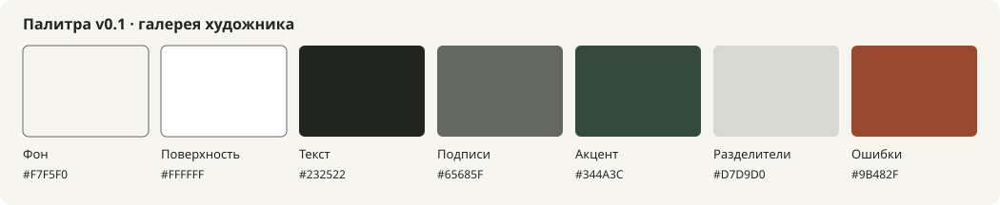

# Дизайн-система и удобство

Актуальное реализованное направление — [минимальная галерея: картины сразу](../design/MINIMAL.md). Текущие токены находятся в `src/styles/tokens.css`, приложение использует обычный CSS без Tailwind. Ниже сохранено исходное предложение для истории обсуждения.

Статус исходного документа: направление для прототипа. Фотографий работ друга пока нет, поэтому цветовой акцент и характер типографики предварительные. Это наша палитра, не извлечённые цвета сайтов-референсов.

## Направление

Спокойная современная галерея: светлый нейтральный фон, крупные изображения без обрезки, читаемые подписи, достаточно воздуха. Основная эмоциональная выразительность — в картинах и голосе художника. Форма заказа выглядит дружелюбной и короткой, а цена и следующий шаг доступны без поиска по странице.

На главной два разных действия: «Посмотреть работы» и «Картина на заказ». Соцсети помогают познакомиться с автором, но не заменяют информацию о цене и процессе. Не используем автозвук, курсор-эффекты, обязательные всплывающие подписки и загрузочные интро. Движение — короткие ненавязчивые переходы, отключаемые через `prefers-reduced-motion`.

После получения 6–10 реальных работ проверяем эту нейтральную основу рядом с ними. При необходимости меняем один акцент и типографическую пару, сохраняя контракты токенов и компонентов.

## Палитра v0.1 · архив исходного предложения



| Семантический токен  | Значение  | Назначение                      |
| -------------------- | --------- | ------------------------------- |
| `--color-background` | `#F7F5F0` | Основной фон                    |
| `--color-surface`    | `#FFFFFF` | Поля и отдельные поверхности    |
| `--color-text`       | `#232522` | Заголовки и основной текст      |
| `--color-text-muted` | `#65685F` | Подписи и пояснения             |
| `--color-accent`     | `#344A3C` | Основная кнопка, ссылки, фокус  |
| `--color-border`     | `#D7D9D0` | Декоративные разделители        |
| `--color-error`      | `#9B482F` | Ошибки, всегда вместе с текстом |

Рассчитанные контрасты: основной текст на фоне — 14.18:1; вторичный — 5.21:1; белый на акцентной кнопке — 9.59:1; ошибка на фоне — 5.73:1. Эти значения проверены вычислением относительной яркости для указанных пар; они не заменяют проверку всего интерфейса. Светлый border не используем как единственный способ различить поле: у поля есть постоянная подпись и достаточно контрастная граница/фон, при необходимости граница берёт более тёмный токен.

Выносим цвета, шрифты, отступы и состояния в единый файл `tokens.css`, затем связываем с Tailwind. В компонентах используем семантические имена вместо случайных hex-значений. Пример будущего контракта:

```css
:root {
  --color-background: #f7f5f0;
  --color-surface: #ffffff;
  --color-text: #232522;
  --color-text-muted: #65685f;
  --color-accent: #344a3c;
  --color-border: #d7d9d0;
  --color-control-border: #65685f;
  --color-error: #9b482f;
  --radius-control: 0.5rem;
  --space-unit: 0.25rem;
  --content-max: 80rem;
}
```

Отдельную тёмную тему в MVP не делаем: сначала проверяем нейтральный фон, точность показа работ и читабельность на реальных экранах.

## Типографика и сетка

Предложение: **Manrope** для интерфейса и **Lora** для крупных заголовков/авторского текста. У обеих есть кириллица и латиница в метаданных Google Fonts [D1–D2 в REFERENCES.md](REFERENCES.md). Проверяем сочетание на настоящем имени художника, длинных названиях и двух языках. Шрифты размещаем локально с лицензиями, ограничиваем начальные начертания.

- Базовый текст 16–18 px, высота строки примерно 1.5–1.6; цены не делаем мелкой подписью.
- Отступы кратны 4 px: 4, 8, 12, 16, 24, 32, 48, 64. Интервалы между разделами адаптивны.
- Контент до 1280 px; боковые поля 16–24 px на телефоне, шире на больших экранах.
- Каталог: 1–2 колонки на телефоне в зависимости от ширины и читаемости, 3–4 на широком экране. Выбор фиксируем в прототипе.
- Превью сохраняет целую работу в нейтральной области; фотографии деталей можно кадрировать отдельно. В карточке фиксируем геометрию, чтобы загрузка изображений не сдвигала текст.
- Интерактивные цели проектируем от 44×44 px; фокус клавиатуры заметен, подписи постоянные, не только placeholder.
- Проверяем ширины 360, 390, 768 и 1440 px, масштабирование текста и длинные английские строки.

## Компоненты до страниц

Сначала создаём небольшой набор: Button/Link, Field/Select/RadioGroup, StatusBadge, ArtworkCard, Gallery, Price, EstimateSummary, FormStep, InlineError, EmptyState и SuccessState. Для каждого определяем обычное состояние, фокус, загрузку, ошибку, отсутствие данных и отключённое действие, где они нужны.

`StatusBadge` всегда подписан текстом. Карточки и цены не используют hover как единственный способ получить важную информацию. Публичные страницы и админка могут выглядеть по-разному, но названия статусов и смысл полей одинаковы.

## Что именно показываем в прототипе

1. Мобильная главная: представление, готовые работы, заказ, процесс, художник и контакты.
2. Каталог с доступной/резервной/проданной работой, пустым фильтром и длинным названием.
3. Карточка с полной фотографией, деталями, ценой и заявкой.
4. Форма заказа: стандартный портрет, свой размер, «не знаю», нет подходящего правила, закрыт приём заказов.
5. Экран ориентира: диапазон, срок с учётом просушки, доставка отдельно, дальнейший шаг.
6. Успех и ошибка сохранения; выбранный канал отсутствует в env; повторная отправка после сбоя сети.
7. Все основные состояния на RU и EN.

Прототип можно сначала сделать на явно обозначенных локальных demo-данных. Переход в рабочую версию не должен требовать заново переписывать компоненты, словари и токены.

## Тон общения

Пишем спокойно и конкретно. Вместо «Свяжитесь для обсуждения деталей» объясняем: «Выберите размер и технику — покажем ориентир цены и срока». Вместо обещания «Через 2 недели у вас» пишем согласованный диапазон готовности и отделяем доставку. Если данных нет, предлагаем уточнение без придуманной цифры.

Для сложного выбора есть вариант «Помогите выбрать». Поля бюджета и референса необязательные. Не просим одновременно телефон, email и три мессенджера. Если человек не хочет форму, прямая связь остаётся доступной.

Черновые тексты не являются обещаниями художника. До запуска он подтверждает цену, время ответа, состав услуги, правила правок и публикацию заказной работы в портфолио.
