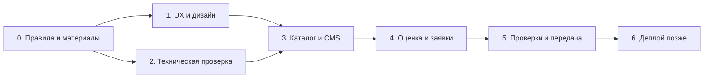

# Roadmap

Сначала локальное приложение, затем отдельный этап запуска. Один завершённый этап — один небольшой проверяемый результат; при наличии настроенного GitHub каждый можно оформить отдельным PR. Завершённые изменения фиксируются коммитами; большие пункты разрабатываются в отдельных ветках.

## Текущая итерация · 29 октября 2026

- [x] Сохранить работающее приложение до изменений: `baseline/local-studio-v1`, коммит `1817790`.
- [x] Подсказки художнику, автоматическая ссылка и понятные цены; список валют RUB/USD/EUR: `feat/friendly-admin`, коммит `adbfdfc`.
- [x] Обновить витрину, сократить текст и футер, проверить RU/EN и мобильную ширину: `feat/editorial-gallery`, [описание](../design/REFRESH.md).
- [x] Последним шагом подготовить [два изображения палитр](../design/directions/README.md) для выбора художником: `docs/palette-directions`.

Общая ветка результатов — `work/studio-refresh`. Деплой и внешние уведомления не входят в эту итерацию. Пользовательская проверка художником остаётся отдельным шагом.

## Первый локальный билд — 29 октября 2026

Реализованы витрина RU/EN, каталог из Payload/PostgreSQL, карточки работ, фильтры, страницы художника/связи, формы трёх типов, оценка по правилам, сохранение заявок и приватные референсы. Имя, псевдоним и контакты настраиваются через env или CMS. Существуют локальная инструкция, unit- и интеграционные smoke-проверки. Это первый сквозной результат, а не завершение всех этапов ниже.

Остаются полный пользовательский прогон и проверка на устройствах, согласованный контент, роли, атомарные действия резерва, уведомления с очередью и подготовка запуска. Текущая реализация и ограничения описаны в [README](../../README.md).

Оценки ниже — инженерный ориентир для одного разработчика при регулярной обратной связи, не календарное обещание. Они включают реализацию и проверки; ожидание контента, новые требования и подключение внешних аккаунтов меняют срок.

## Порядок и зависимости

M1 и M2 независимы по содержанию, но могут выполняться последовательно одним разработчиком. До M3 проверяем, что выбранная CMS действительно удобна владельцу и работает с нужными версиями.

## M0. Уточнить продукт и материалы — 0.5–1.5 дня

- [x] Зафиксировать RU/EN, заявку вместо оплаты, env-контакты и локальную разработку до деплоя.
- [x] Подготовить первичное сравнение стека, ссылки на референсы и предлагаемую палитру.
- [ ] Обсудить это предложение и выбрать основное визуальное направление.
- [ ] Получить примеры работ или согласовать временные demo-данные для разработки.
- [ ] Составить таблицу техники/сюжета/размера, цены и срока; если реальных данных пока нет, явно отделить тестовый набор от будущего публичного.
- [ ] Уточнить минимальные поля заявки, способы связи, смысл резерва и срок ответа.

**Готово, когда:** понятно, что именно демонстрирует первая версия, какие данные временные и кто подтверждает реальные значения. Отсутствие страны или готового домена не блокирует локальную разработку.

## M1. Прототип и дизайн-система — 2–3 дня

- [ ] Собрать токены палитры, шрифтов, отступов, форм и состояний по [DESIGN.md](DESIGN.md).
- [ ] Подготовить мобильные главную, каталог, карточку и форму с ориентиром; затем адаптацию для большого экрана.
- [ ] Показать RU и EN, длинные строки, unavailable/sold, ручное уточнение, успех и сбой формы.
- [ ] Проверить сценарии на 3–5 людях и скорректировать непонятные шаги.

**Готово, когда:** человек самостоятельно находит цену/условия и понимает разницу между предварительной заявкой и согласованным заказом; ключевые экраны и палитра выбраны. Проверки не требуют реальных внешних сообщений.

## M2. Техническая основа и проверка рисков — 1.5–3 дня

- [ ] Поднять локальные Next.js + Payload + PostgreSQL и зафиксировать совместимые версии, Node.js и lockfile.
- [ ] Создать auth сотрудников, закрыть публичную регистрацию; проверить роли владельца и редактора.
- [ ] Сделать одну тестовую работу на RU/EN, черновик/публикацию, загрузку публичного изображения и приватного референса.
- [ ] Проверить, что приватный файл недоступен гостю через UI, прямую ссылку и API.
- [ ] Подтвердить транзакционное сохранение заявки и задания уведомления, а также реальный способ запуска обработчика.
- [ ] Настроить `messages`, `contacts.ts`, `.env.example`, игнорирование секретов, локальную БД и безопасные demo-данные.
- [ ] Добавить воспроизводимые команды установки, запуска, миграций и проверки сборки; настроить базовый CI.

**Готово, когда:** чистый checkout запускается по инструкции; владелец открывает админку; гость видит только разрешённые данные; обработчик выполняет тестовое задание. При неудаче меняем техническое решение здесь, до разработки всего интерфейса.

## M3. Каталог и самостоятельная работа художника — 2–4 дня

- [ ] Создать Artworks, PublicMedia, ArtistProfile, FAQ и SiteSettings.
- [ ] Собрать страницы витрины на настоящих данных CMS, включая черновики, пустой каталог и проданные работы.
- [ ] Реализовать галерею, основные фильтры при необходимости, доступность, цену/валюту, SEO и превью ссылки.
- [ ] Настроить проверку переводов и сброс кэша после публикации.
- [ ] Дать владельцу самому добавить картину с фото, ценой и переводом, затем изменить её и отметить продажу.

**Готово, когда:** новая картина появляется без изменения кода; на RU/EN корректные текст, размеры и валюта; черновик и закрытые данные не видны публике; проданное состояние не предлагает обычную покупку.

## M4. Ориентиры и заявки — 3–5 дней

- [ ] Создать QuoteRules, Requests и PrivateReferences; состояния, снимки оценки и историю административных действий.
- [ ] Реализовать оценку по совпадающему правилу и ручное уточнение для остальных случаев; учесть закрытый приём заказов.
- [ ] Сделать три формы: готовая картина, индивидуальная работа, общий вопрос.
- [ ] Добавить серверную валидацию, ограничение запросов и файлов, повторную проверку цены/наличия, идемпотентность.
- [ ] Реализовать резерв и продажу через проверенные действия админки.
- [ ] Сохранить заявки и тестовые уведомления с повторными попытками; показать ошибки доставки в админке.
- [ ] Подключить заданные в env ссылки, копирование резюме и понятный переход к личному общению без автоматической отправки сообщений.

**Готово, когда:** от выбора до записи в админке проходит каждый сценарий на двух языках; повторный клик создаёт одну заявку; сбой канала не теряет обращение; свой размер не получает вымышленную оценку; конкурирующие действия не резервируют одну картину дважды.

## M5. Проверки и передача локального приложения — 2–3 дня

- [ ] Прогнать критические сценарии ниже; исправить найденные проблемы.
- [ ] Проверить мобильную галерею, ввод и загрузку файлов, клавиатуру, увеличение текста, обе локали и длинный контент.
- [ ] При доступном устройстве проверить Safari iOS и встроенный браузер Instagram; явно отметить непроверенное.
- [ ] Подготовить короткую инструкцию художнику: добавить работу, настроить правило, найти заявку, резервировать и снять резерв.
- [ ] Подготовить developer README: setup, env, миграции, тестовые данные, обработчик заданий, диагностика без утечки контактов.
- [ ] Составить отдельный список действий для деплоя, не подключая незапрошенные сервисы.

**Готово, когда:** локальное приложение воспроизводимо, основные сценарии подтверждены, художник может управлять данными; ограничения и оставшиеся действия перед публичным запуском перечислены.

Суммарный ориентир M0–M5: **11–20 рабочих дней**, без ожидания материалов. Сначала уточняем оценку после M1–M2; это полезнее, чем сейчас обещать дату без картин, реальных расценок и проверки CMS.

## M6. Подготовка и деплой — позже, отдельный объём

- [ ] Выбрать домен, страну/регион размещения, провайдеров и бюджет.
- [ ] Согласовать реальные правила обработки данных, хранения и удаления референсов, условия продажи и доставки под фактическую деятельность.
- [ ] Заменить demo-данные, проверить все переводы, цены, контакты и сроки с художником.
- [ ] Настроить production Node.js, PostgreSQL, публичные и приватные файлы, секреты, HTTPS и обработчик заданий.
- [ ] Подключить выбранное уведомление художнику, проверить реальные получение и повтор после сбоя; для почты настроить доменную аутентификацию.
- [ ] Проверить защиту входа, восстановление доступа, отсутствие публичных референсов/заявок, ограничения загрузок и запросов.
- [ ] Настроить резервное копирование и выполнить пробное восстановление; согласовать ответственного и периодичность проверок.
- [ ] Настроить ошибки и доступность сервиса; не включать персональные данные в логи и аналитику.
- [ ] Проверить production-сценарии, обновление контента без потери заявок и откат релиза.

**Готово, когда:** художник получает реальную заявку, данные сохраняются и восстанавливаются, контакты работают, нет тестовых обещаний и нет незакрытых критических рисков. Деплой не выполняется в текущем задании по планированию.

## Минимальные проверяемые сценарии

| Проверка                                    | Ожидаемый результат                                             |
| ------------------------------------------- | --------------------------------------------------------------- |
| RU → EN на карточке                         | Та же работа, переведённые подписи и тексты, прежняя валюта     |
| Публикация без обязательного перевода       | Неготовая локаль не публикуется                                 |
| Портрет/масло/стандартный размер с правилом | Показан соответствующий диапазон цены и готовности              |
| Свой размер / нет правила / конфликт правил | Ручное уточнение, нет придуманной цифры                         |
| Правило поменялось перед отправкой          | Новые условия показаны человеку до подтверждения                |
| Работа продана после открытия карточки      | Сервер не принимает обычную заявку на покупку как актуальную    |
| Две параллельные попытки резерва            | Только одно действие получает резерв                            |
| Двойной клик / сетевой повтор               | Одна заявка на один idempotency key                             |
| Недоступна БД                               | Ошибка без ложного подтверждения успеха                         |
| Недоступен канал уведомлений                | Обращение в БД, повторная попытка, ошибка видна владельцу       |
| Гость открывает референс или список заявок  | Доступ запрещён, в том числе через CMS API                      |
| Ссылка на чужой временный файл              | Нельзя прикрепить к своей заявке                                |
| Неверный тип / слишком большой файл         | Понятная ошибка без потери остальных полей                      |
| Нет контакта в env                          | Нет сломанной ссылки; приём локальных тестовых заявок обозначен |

Юнит-проверки — для расчёта, диапазонов и переходов состояний; интеграционные — для транзакций, прав и параллельного резерва; E2E — для реальных пользовательских путей. Не проверяем тестами каждую CSS-переменную или текстовый блок.

## После первых реальных заявок

Сначала собираем обратную связь: на каких параметрах люди останавливаются, насколько полезны ориентиры, сколько ручного уточнения нужно художнику. Затем выбираем следующий результат: очередь и загрузка, уведомления клиенту, интеграция с CRM или управление контактами через CMS. Платежи и корзина появляются только при подтверждённом изменении сценария.
